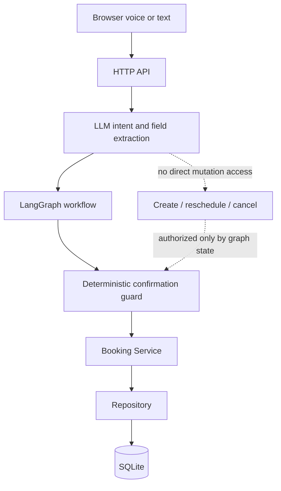
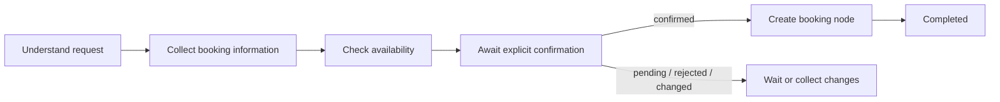

# AI Voice Booking Agent

[](https://github.com/siopoo/ai-voice-booking-agent/actions/workflows/ci.yml)
[](https://www.python.org/downloads/)
[](LICENSE)

A configurable, production-oriented AI voice appointment booking agent built with LangGraph and deterministic business workflows.

## What This Project Shows

- **Safe LLM boundary:** the model interprets intent and extracts fields, but it cannot directly create, reschedule, or cancel bookings.
- **Deterministic workflow control:** LangGraph owns state transitions, confirmation gates, and mutation authorization.
- **Reliability under retries and concurrency:** idempotency records and a SQLite partial unique index protect against duplicate writes and slot conflicts.
- **Verifiable Agent behavior:** the repository includes offline tests and deterministic Agent evaluations that run without paid model credentials.

## Overview

Most AI booking demos let the LLM directly modify business data. This project deliberately separates language understanding from business authority.

The LLM understands user intent and extracts information. LangGraph controls workflow state. The service layer enforces booking rules. The database provides consistency guarantees. The included pet-grooming business is an example configuration, not a constraint on the booking engine.

## Why This Project

Appointment booking combines probabilistic language understanding with operations that must be deterministic: checking availability, obtaining explicit confirmation, preventing duplicates, and resolving concurrent writes. A prompt alone is not a sufficient authorization boundary.

This repository demonstrates how to keep an LLM useful without making it authoritative. It is designed as a local-first reference implementation that can run, test, and evaluate its core booking lifecycle without an API key.

## Features

- Create, query, reschedule, and cancel appointments.
- Deterministic LangGraph workflow for all booking mutations.
- Explicit confirmation guards before create, reschedule, or cancel.
- Availability validation against hours, closures, service duration, booking window, and occupied slots.
- Idempotency records for retry-safe booking creation.
- SQLite partial unique index for concurrent slot protection.
- Read-only LLM tool boundary; the model cannot directly mutate booking data.
- Reliable mode with no LLM dependency and Agent mode with OpenAI-compatible providers.
- Browser speech recognition, OpenAI-compatible STT, or local SenseVoice.
- Configurable business facts, services, hours, language, and welcome message.
- Service/repository separation, typed errors, structured logging, and sensitive-data redaction.
- Offline pytest suite, deterministic Agent evaluation, frontend tests, Docker, and CI.

## Demo

The built-in web interface supports voice or text booking and exposes the current draft, workflow stage, and tool trace. The default configuration models a pet-grooming business; alternative configurations can use the same workflow without duplicating business logic.

```text
http://127.0.0.1:8000/
```

The interface is fully runnable locally and exposes the current booking draft, workflow stage, and tool trace. For portfolio review, the recommended demo flow is: create a booking → obtain explicit confirmation → persist successfully → query, reschedule, or cancel the booking. A short real-capture GIF can be added under `docs/assets/` later without changing the application.

## Architecture



The dependency direction is deliberately simple:

```text
LLM: interpret and propose
        ↓
LangGraph: validate state and authorize transitions
        ↓
Service: enforce booking rules and transaction semantics
        ↓
Repository: persist and query data
        ↓
SQLite: enforce final consistency constraints
```

See [Architecture](docs/ARCHITECTURE.md) and [Design Decisions](docs/DESIGN_DECISIONS.md) for the boundaries and trade-offs.

## LangGraph Workflow

Create:



Reschedule and cancel first resolve a specific existing booking. Multiple matches enter `awaiting_booking_selection`; no model-generated guess is accepted. Date, time, or service changes invalidate stale availability and confirmation state.

## Quick Start

Requirements: Python 3.11+ and, for frontend tests, Node.js 20+.

```bash
python -m venv .venv
```

Activate the environment (`source .venv/bin/activate` on macOS/Linux or `.\.venv\Scripts\Activate.ps1` in PowerShell), then run:

```bash
python -m pip install -r requirements.txt
cp .env.example .env
python server.py
```

On PowerShell, use `Copy-Item .env.example .env` instead of `cp`. Open <http://127.0.0.1:8000/>. Reliable mode works without an API key.

Docker is also supported:

```bash
docker compose up --build
```

## Configuration

Business behavior is configured in [`config/business.json`](config/business.json). It contains the business name, timezone, opening hours, closed weekdays, booking window, services, appointment slots, language, and welcome message.

Example configurations:

- [`config/examples/pet_grooming.json`](config/examples/pet_grooming.json)
- [`config/examples/salon.json`](config/examples/salon.json)

Select a configuration without changing application code:

```dotenv
PAWPILOT_BUSINESS_CONFIG_PATH=config/examples/salon.json
```

Model configuration:

```dotenv
PAWPILOT_LLM_API_KEY=your-api-key
PAWPILOT_LLM_MODEL=your-model
PAWPILOT_LLM_BASE_URL=https://api.openai.com/v1
```

STT can use an OpenAI-compatible transcription endpoint or local SenseVoice. See [`.env.example`](.env.example) for every setting.

> `PAWPILOT_*` names are legacy environment variable names retained for backward compatibility. Renaming them would be a breaking change; new generic aliases are planned for a future major release.

## API

| Method | Endpoint | Purpose |
|---|---|---|
| `GET` | `/api/health` | Health and version information |
| `GET` | `/api/config` | Current business facts and services |
| `GET` | `/api/slots?date=&service_id=` | Available appointment slots |
| `GET` | `/api/bookings` | Redacted operational booking list |
| `POST` | `/api/bookings` | Create a booking; supports `Idempotency-Key` |
| `POST` | `/api/bookings/query` | Find a booking by code or phone |
| `POST` | `/api/bookings/reschedule` | Reschedule after explicit confirmation |
| `POST` | `/api/bookings/cancel` | Cancel after explicit confirmation |
| `POST` | `/api/chat` | Run an Agent conversation turn |
| `POST` | `/api/agent/interpret` | Reliable-mode intent and draft interpretation |
| `POST` | `/api/transcribe` | Transcribe audio |
| `GET/POST` | `/api/onboarding/applications` | Business onboarding workflow |

This is a demonstration API and currently has no authentication. Do not expose it directly to the public internet.

## Safety & Reliability

- **Deterministic mutations:** create, reschedule, and cancel are executed only by guarded LangGraph nodes.
- **Untrusted model output:** LLM tool-call arguments and generated messages are never treated as authorization.
- **Confirmation safety:** the last real user message is classified deterministically before a write transition.
- **State invalidation:** changing date, time, or service invalidates derived availability and prior confirmation.
- **Idempotency:** repeated requests with the same key replay the original response rather than writing twice.
- **Concurrency protection:** a database unique constraint is the final authority for slot conflicts.
- **Fact grounding:** services, prices, hours, and slots come from configuration or persisted state.
- **Privacy-aware logging:** phone numbers, authorization headers, tokens, and API keys are redacted.
- **Offline CI:** automated tests and evaluations run with model and STT credentials disabled.

## Evaluation

Run the complete local quality suite:

```bash
python -m pip install -r requirements-dev.txt
ruff check .
pytest -q
python -m evals.run_evals
npm test
```

Current verified baseline:

| Check | Result |
|---|---:|
| Python tests | 82 passed |
| Deterministic Agent scenarios | 30 / 30 passed |
| Confirmation safety rate | 100% |
| Duplicate writes in eval | 0 |
| Business-fact hallucinations in eval | 0 |
| Frontend test scripts | 5 passed |

The Agent evaluation is offline and uses deterministic service adapters, so it does not call a paid model API or require secrets.

## Project Structure

```text
app/
  agents/          LangChain prompts/tools boundary and LangGraph workflow
  api/             HTTP routing, serialization, and safe error mapping
  core/            settings, typed exceptions, and logging
  db/              SQLite connection and schema
  repositories/    persistence and data mapping
  services/        booking, onboarding, and speech business rules
config/
  business.json    active default business configuration
  examples/        reusable business configuration examples
docs/              architecture, decisions, security, and setup notes
evals/             deterministic booking scenarios and runner
static/            browser UI and voice-session modules
tests/             unit, integration, and Agent boundary tests
server.py          composition root and compatible application entry point
booking_agent.py   Agent integration and compatible public facade
booking_workflow.py backward-compatible workflow imports
business_config.py business configuration validation and persistence
```

Root-level compatibility modules and JavaScript test runners remain in place to avoid breaking existing imports and CI commands. They are active entry points or intentional facades, not generated artifacts.

## Design Decisions

Key decisions are documented in [docs/DESIGN_DECISIONS.md](docs/DESIGN_DECISIONS.md):

- Why LangGraph is used instead of prompt-only tool calling.
- Why the LLM cannot create bookings directly.
- Why SQLite is appropriate for the current local-first scope.
- Why idempotency protects both user retries and network retries.
- Why service and repository layers remain separate.
- Why reliable mode exists alongside Agent mode.

## Known Limitations

- Session state is stored in process memory and is not shared across instances.
- SQLite targets local and single-instance deployments, not high-throughput distributed workloads.
- The standard-library HTTP server does not provide production authentication, schema generation, or advanced middleware.
- There is no SIP, telephony provider, TTS pipeline, or human handoff yet.
- The default Docker image excludes the larger local SenseVoice runtime.
- Business configuration is single-tenant and file-based.

## Roadmap

- [ ] FastAPI / ASGI migration
- [ ] PostgreSQL repository
- [ ] Redis / PostgreSQL LangGraph checkpointing
- [ ] TTS support
- [ ] SIP / Twilio integration
- [ ] Multi-tenant business configurations
- [ ] OpenTelemetry observability
- [ ] Web admin dashboard

## Contributing

Contributions are welcome. Read [CONTRIBUTING.md](CONTRIBUTING.md) for development setup, quality checks, and pull-request expectations. For vulnerabilities, follow [SECURITY.md](SECURITY.md) instead of opening a public issue.

## License

This project is licensed under the [MIT License](LICENSE).
