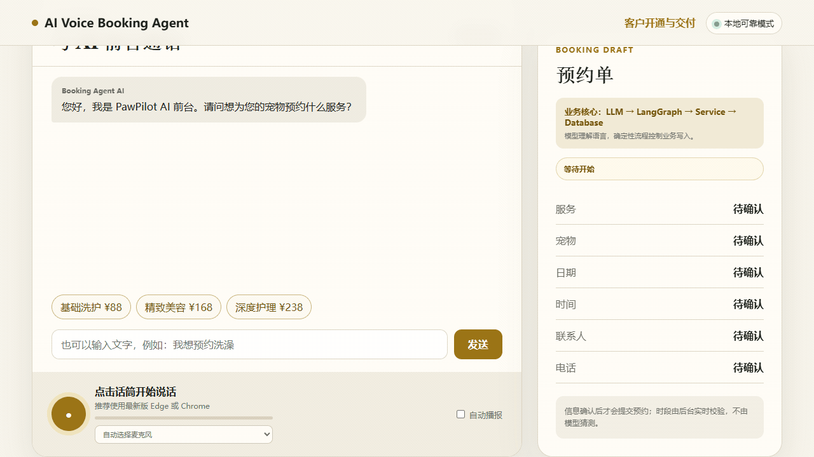
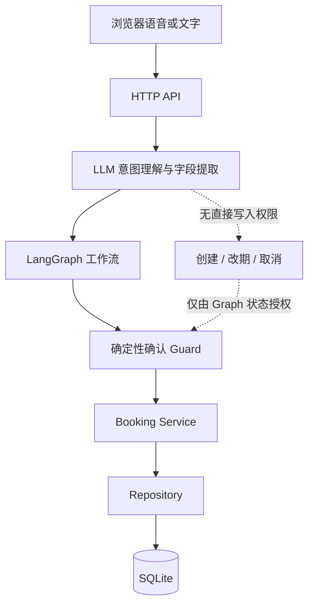
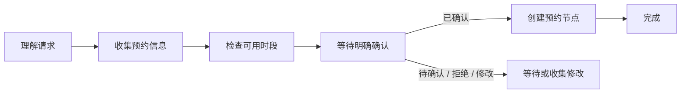

# AI Voice Booking Agent

[English](README.md) | 简体中文

[](https://github.com/siopoo/ai-voice-booking-agent/actions/workflows/ci.yml)
[](https://www.python.org/downloads/)
[](LICENSE)

一个使用 LangGraph 与确定性业务工作流构建、可配置且面向生产实践的 AI 语音预约 Agent。

## 项目概览

许多 AI 预约 Demo 允许 LLM 直接修改业务数据。本项目刻意将自然语言理解与业务操作权限分离。

LLM 负责理解用户意图和提取信息，LangGraph 负责控制工作流状态，Service 层负责执行预约规则，数据库负责提供最终的一致性保障。仓库内置的宠物护理门店只是示例配置，并不限制预约引擎的适用行业。

## 为什么开发这个项目

预约业务把概率性的语言理解和必须确定执行的操作组合在一起，包括查询可用时段、获得明确确认、防止重复写入以及处理并发冲突。单靠 Prompt 不能形成可靠的授权边界。

本项目展示如何使用 LLM 的语言能力，同时不让它掌握最终业务权限。它是一个本地优先的参考实现：即使没有 API Key，也能运行、测试和评测完整的预约生命周期。

## 功能特性

- 创建、查询、改期和取消预约。
- 所有预约写操作都由确定性的 LangGraph 工作流控制。
- 创建、改期或取消前必须通过明确确认 Guard。
- 根据营业时间、休息日、服务时长、预约窗口和已占用时段校验可用性。
- 使用幂等记录确保重试不会重复创建预约。
- 使用 SQLite 条件唯一索引保护并发时段。
- LLM 只有读取权限，无法直接修改预约数据。
- 提供不依赖 LLM 的可靠模式，以及兼容 OpenAI API 的 Agent 模式。
- 支持浏览器语音识别、OpenAI-compatible STT 和本地 SenseVoice。
- 可配置业务资料、服务、营业时间、语言和欢迎语。
- Service/Repository 分层、类型化异常、结构化日志和敏感信息脱敏。
- 包含离线 pytest、确定性 Agent Eval、前端测试、Docker 和 CI。

## Demo

内置网页支持语音或文字预约，并展示当前预约草稿、工作流阶段和工具轨迹。默认配置模拟宠物护理门店；其他预约型业务可以复用同一套工作流，无需复制业务逻辑。

```text
http://127.0.0.1:8000/
```



## 系统架构



依赖方向保持简单且明确：

```text
LLM：理解语言并提出操作
        ↓
LangGraph：验证状态并授权迁移
        ↓
Service：执行预约规则与事务语义
        ↓
Repository：持久化与查询数据
        ↓
SQLite：执行最终一致性约束
```

详细边界与取舍请阅读[架构文档](docs/ARCHITECTURE.md)和[设计决策](docs/DESIGN_DECISIONS.md)。

## LangGraph 工作流

创建预约：



改期和取消前会先定位一条具体预约。找到多条记录时进入 `awaiting_booking_selection`，不会接受模型的猜测。日期、时间或服务发生变化后，旧的可用时段和确认状态会立即失效。

## 快速开始

环境要求：Python 3.11+；运行前端测试还需要 Node.js 20+。

```bash
python -m venv .venv
```

激活虚拟环境（macOS/Linux 使用 `source .venv/bin/activate`，PowerShell 使用 `.\.venv\Scripts\Activate.ps1`），然后执行：

```bash
python -m pip install -r requirements.txt
cp .env.example .env
python server.py
```

PowerShell 请使用 `Copy-Item .env.example .env` 代替 `cp`。随后打开 <http://127.0.0.1:8000/>。可靠模式无需 API Key。

也可以使用 Docker：

```bash
docker compose up --build
```

## 配置

业务行为由 [`config/business.json`](config/business.json) 控制，其中包括业务名称、时区、营业时间、休息日、预约窗口、服务项目、预约时段、语言和欢迎语。

示例配置：

- [`config/examples/pet_grooming.json`](config/examples/pet_grooming.json)
- [`config/examples/salon.json`](config/examples/salon.json)

无需修改应用代码即可切换配置：

```dotenv
PAWPILOT_BUSINESS_CONFIG_PATH=config/examples/salon.json
```

大模型配置：

```dotenv
PAWPILOT_LLM_API_KEY=your-api-key
PAWPILOT_LLM_MODEL=your-model
PAWPILOT_LLM_BASE_URL=https://api.openai.com/v1
```

STT 可以使用 OpenAI-compatible 转写接口或本地 SenseVoice。所有配置项见 [`.env.example`](.env.example)。

> `PAWPILOT_*` 是为向后兼容而保留的旧环境变量名称。直接重命名会造成 breaking change；未来主版本可在提供弃用周期后增加通用别名。

## API

| 方法 | 接口 | 用途 |
|---|---|---|
| `GET` | `/api/health` | 健康状态与版本信息 |
| `GET` | `/api/config` | 当前业务资料与服务列表 |
| `GET` | `/api/slots?date=&service_id=` | 查询可用预约时段 |
| `GET` | `/api/bookings` | 获取已脱敏的运营预约列表 |
| `POST` | `/api/bookings` | 创建预约，支持 `Idempotency-Key` |
| `POST` | `/api/bookings/query` | 使用预约编号或手机号查找预约 |
| `POST` | `/api/bookings/reschedule` | 明确确认后改期 |
| `POST` | `/api/bookings/cancel` | 明确确认后取消 |
| `POST` | `/api/chat` | 执行一次 Agent 对话 |
| `POST` | `/api/agent/interpret` | 可靠模式的意图和草稿解析 |
| `POST` | `/api/transcribe` | 音频转文字 |
| `GET/POST` | `/api/onboarding/applications` | 业务开通工作流 |

这是一个演示 API，目前没有身份认证。添加认证、授权和 TLS 等保护前，请勿直接暴露到公网。

## 安全性与可靠性

- **确定性写入：** 创建、改期和取消仅由受 Guard 保护的 LangGraph 节点执行。
- **不信任模型输出：** LLM 生成的工具参数和消息均不能作为授权依据。
- **确认安全：** 写入迁移前，根据最后一条真实用户消息进行确定性确认分类。
- **状态失效：** 修改日期、时间或服务后，旧的可用性和确认立即失效。
- **幂等保护：** 使用同一幂等键重试时返回首次结果，不重复写入。
- **并发保护：** 数据库唯一约束是时段冲突的最终裁决者。
- **事实落地：** 服务、价格、营业时间和时段来自配置或持久化状态。
- **隐私日志：** 手机号、Authorization、Token 和 API Key 会被脱敏。
- **离线 CI：** 自动测试和评测会禁用模型及 STT 凭据。

## 评测

运行完整的本地质量检查：

```bash
python -m pip install -r requirements-dev.txt
ruff check .
pytest -q
python -m evals.run_evals
npm test
```

当前已验证基线：

| 检查项 | 结果 |
|---|---:|
| Python 测试 | 82 passed |
| 确定性 Agent 场景 | 30 / 30 passed |
| 明确确认安全率 | 100% |
| Eval 重复写入 | 0 |
| Eval 业务事实幻觉 | 0 |
| 前端测试脚本 | 5 passed |

Agent Eval 使用确定性的 Service 适配器并完全离线运行，因此不会调用收费模型 API，也不需要密钥。

## 项目结构

```text
app/
  agents/          LangChain 提示词/工具边界和 LangGraph 工作流
  api/             HTTP 路由、序列化和安全错误映射
  core/            配置、类型化异常和日志
  db/              SQLite 连接和 Schema
  repositories/    持久化与数据映射
  services/        预约、业务开通和语音业务规则
config/
  business.json    当前默认业务配置
  examples/        可复用业务配置示例
docs/              架构、设计决策、安全及仓库设置说明
evals/             确定性预约场景和运行器
static/            浏览器 UI 和语音会话模块
tests/             单元、集成和 Agent 边界测试
server.py          组合根和兼容应用入口
booking_agent.py   Agent 集成与兼容公共接口
booking_workflow.py 向后兼容的工作流导出
business_config.py 业务配置校验与持久化
```

根目录中的兼容模块和 JavaScript 测试运行器用于避免破坏已有 import 与 CI 命令。它们是活跃入口或有意保留的 Facade，不是生成的临时文件。

## 设计决策

[docs/DESIGN_DECISIONS.md](docs/DESIGN_DECISIONS.md) 记录了以下关键决策：

- 为什么使用 LangGraph，而不是只依赖 Prompt 和 Tool Calling。
- 为什么 LLM 不能直接创建预约。
- 为什么 SQLite 适合当前本地优先范围。
- 为什么幂等机制能保护用户重复操作和网络重试。
- 为什么 Service 和 Repository 必须分层。
- 为什么同时提供可靠模式和 Agent 模式。

## 已知限制

- 会话状态保存在进程内存中，无法在多个实例间共享。
- SQLite 面向本地和单实例部署，不适合高吞吐分布式负载。
- 标准库 HTTP Server 不提供生产级身份认证、Schema 生成或高级中间件。
- 暂未提供 SIP、电话供应商、TTS 流程或人工转接。
- 默认 Docker 镜像不包含体积较大的本地 SenseVoice 运行环境。
- 业务配置目前为单租户文件配置。

## Roadmap

- [ ] 迁移到 FastAPI / ASGI
- [ ] PostgreSQL Repository
- [ ] Redis / PostgreSQL LangGraph Checkpointing
- [ ] TTS 支持
- [ ] SIP / Twilio 集成
- [ ] 多租户业务配置
- [ ] OpenTelemetry 可观测性
- [ ] Web 管理后台

## 参与贡献

欢迎贡献。开发环境、质量检查和 Pull Request 要求请参阅 [CONTRIBUTING.md](CONTRIBUTING.md)。安全漏洞请按照 [SECURITY.md](SECURITY.md) 私下报告，不要提交公开 Issue。

## License

本项目使用 [MIT License](LICENSE)。
